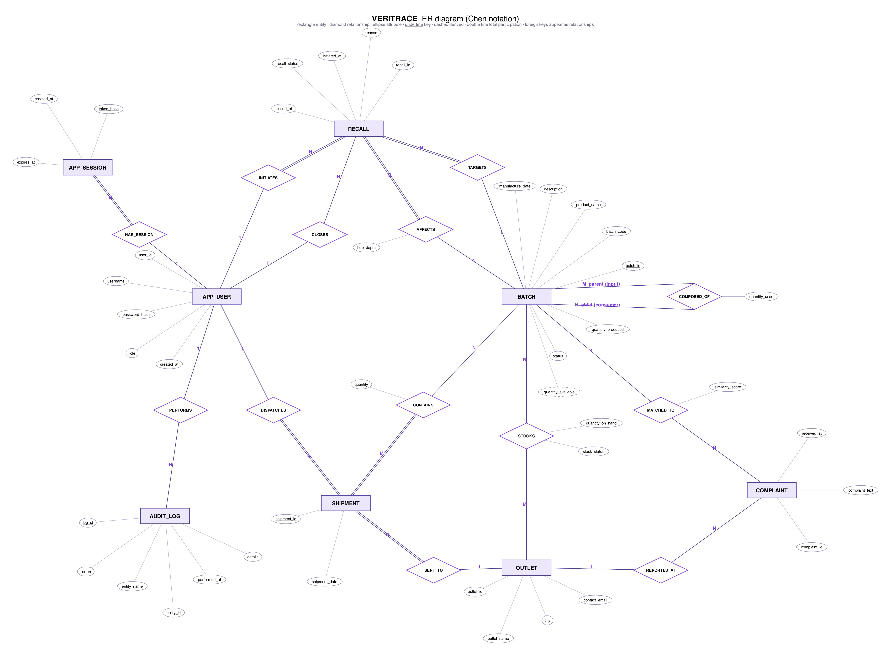
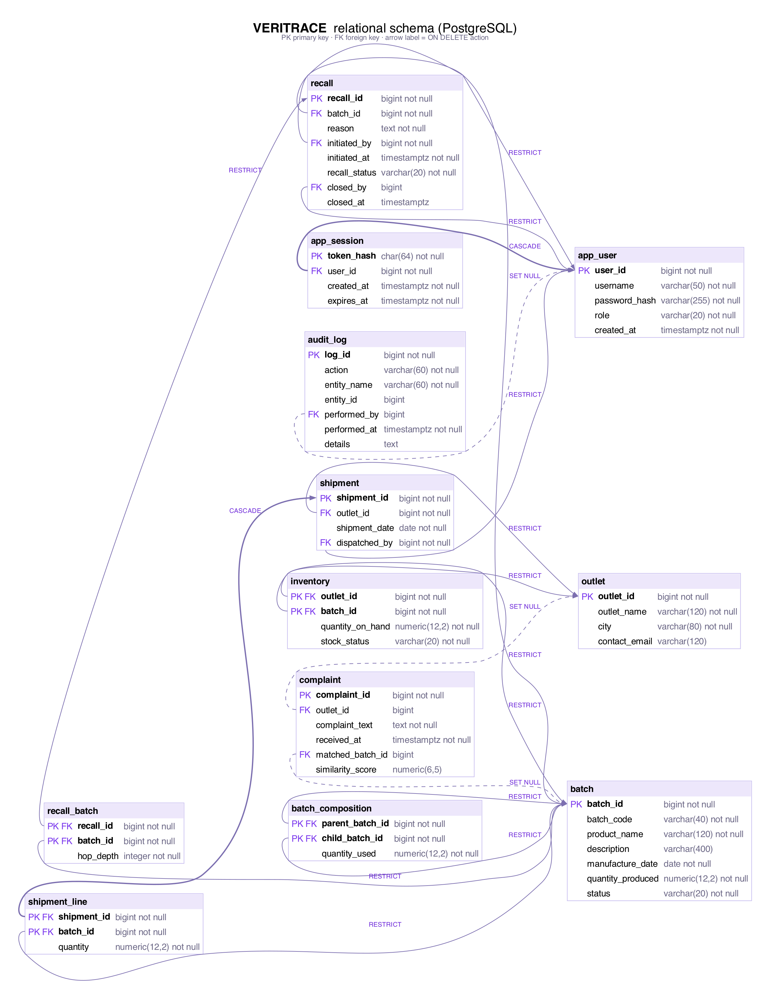
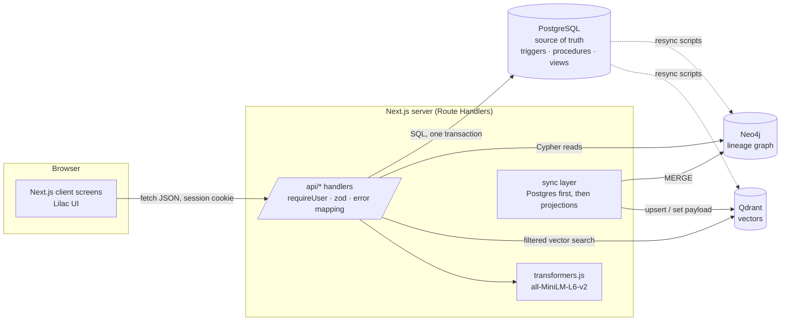
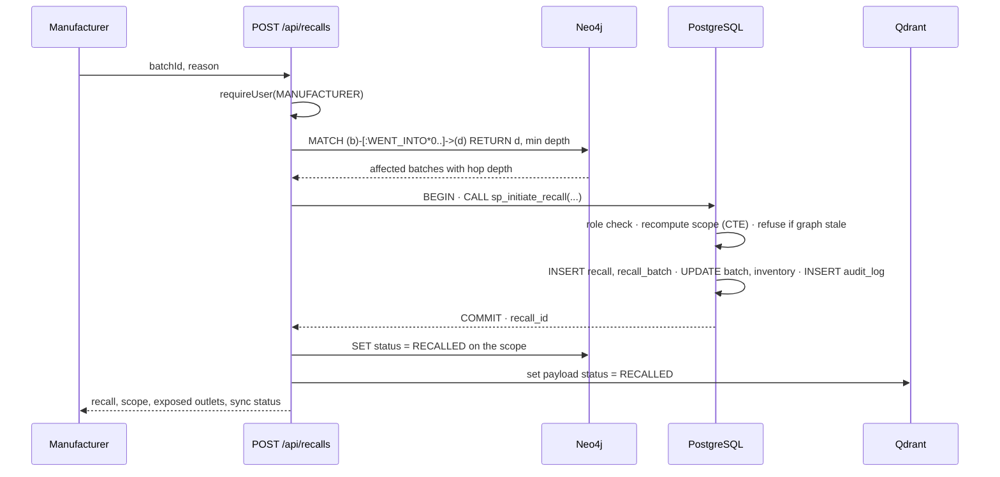

# VERITRACE — Project Report

**Batch Provenance and Recall Cascade Engine**
DBMS Experiential Learning, Level 3 Project
PES University, Department of CSE (AI and ML)
Course Instructor: Dr. Nagasundari S

Ashwin C H (PES1UG24AM900) and Aman Priyanch (PES1UG24AM030)

Version 1.0

---

## Contents

1. Problem statement
2. Objectives
3. Scope
4. Functional requirements
5. ER diagram
6. Relational schema
7. Database choice and justification
8. Data dictionary
9. Database implementation (PostgreSQL, Neo4j, Qdrant)
10. Important queries
11. System architecture
12. Application screenshots
13. Testing results
14. Conclusion and future enhancements

Appendix A: requirement checklist · Appendix B: division of work

---

## 1. Problem statement

In a manufacturing supply chain, goods are produced in identifiable batches, and batches are routinely consumed as inputs into other batches before the finished product is split across shipments to many retail outlets.

When contamination is discovered in a specific batch, the operator must answer two questions with opposite computational characteristics:

* **Backward (provenance):** which input batches went into this batch?
* **Forward (exposure):** which outlets received any product containing material originating from this batch, at any depth of transformation?

The forward question is the difficult one. The chain from a contaminated batch to an affected outlet may pass through one transformation step or five, and the depth is not known when the query is written. In a purely relational model this requires a recursive common table expression: correct, but verbose, and the recursion, the de-duplication and the depth bookkeeping all have to be spelled out by hand.

Executing the recall is a different kind of problem. Marking the batch recalled, quarantining stock at every affected outlet, and writing an audit record must all succeed or all fail. A partial recall, meaning frozen inventory with no record of why, is an unacceptable state. That demands ACID guarantees and referential integrity, which is where a relational engine is strongest and a graph database is weakest.

A third kind of data enters through a different door. Customer complaints arrive as free text with no batch number in them: "bottle smelled off, bought it last Tuesday". Matching these to a suspect batch is a semantic problem, not a keyword one.

One domain, three data shapes, three engines.

---

## 2. Objectives

1. Model a multi-tier supply chain with batch-level composition and distribution in a normalised relational schema, enforcing integrity through primary keys, foreign keys and check constraints.
2. Represent batch lineage and outlet distribution as a directed property graph supporting arbitrary-depth forward and backward traversal.
3. Implement a recall cascade that atomically updates batch status, quarantines affected inventory, and writes an immutable audit trail within a single transaction.
4. Match free-text customer complaints to likely batches using vector similarity search in a dedicated vector database.
5. Prevent dispatch of recalled or quarantined stock through database-level enforcement rather than application-level checks.
6. Expose the system through a role-separated Next.js interface backed by an API layer, with no credentials stored in source code.
7. Demonstrate empirically why each database paradigm was selected, by running the equivalent exposure query in both SQL and Cypher side by side and checking the results agree.

---

## 3. Scope

### 3.1 In scope

* Batch registration, batch-to-batch composition recording, shipment recording and cancellation
* Forward exposure traversal and backward provenance traversal
* Recall initiation with transactional inventory quarantine and audit logging; recall closure
* Database-level rejection of shipments containing recalled, quarantined or over-allocated batches
* Complaint intake, embedding, and similarity matching to candidate batches, with a keyword baseline
* Two-role authentication (Manufacturer, Regulator) with hashed password storage and server-side sessions
* Exposure summary reporting via a database view, and the requirement 6 query set run live

### 3.2 Out of scope

* Live IoT or sensor data ingestion
* Logistics routing, scheduling, or delivery optimisation
* Procurement, invoicing, or payment workflows
* Regulatory filing formats or compliance report generation
* Partial recalls of part of a batch

---

## 4. Functional requirements

### 4.1 Manufacturer role

| ID | Requirement | Where |
|---|---|---|
| FR-1 | Register a new batch with code, product, description, manufacture date and quantity. | Batches · `POST /api/batches` |
| FR-2 | Record that existing batches were consumed as inputs into a batch, with quantity used. | Batches · `POST /api/batches/:id/composition` |
| FR-3 | Record a shipment of one or more batches to an outlet, with quantity per batch. | Shipments · `POST /api/shipments` |
| FR-4 | Cancel a shipment, removing its lines and returning the stock. | Shipments · `DELETE /api/shipments/:id` |
| FR-5 | Put a batch on hold, or release it. | Batches · `PATCH /api/batches/:id` |
| FR-6 | Initiate a recall on any batch, with a reason, after previewing its exposure. | Recalls · `POST /api/recalls` |

### 4.2 Regulator role

| ID | Requirement | Where |
|---|---|---|
| FR-7 | View backward provenance for any batch: the full set of inputs at any depth. | Exposure · trace |
| FR-8 | View the outlet exposure summary per open recall. | Exposure · overview |
| FR-9 | Review complaints with their matched batch and similarity score. | Complaints |
| FR-10 | Inspect the audit log, filterable by action and date. | Complaints · audit |
| FR-11 | Close a recall once no affected stock is left on sale. | Recalls · `PATCH /api/recalls/:id` |

Both roles can trace exposure, compare SQL and Cypher, run the reports, and submit complaints.

### 4.3 System-enforced requirements

| ID | Requirement | Mechanism |
|---|---|---|
| FR-12 | Recall execution updates batch status, quarantines all affected inventory, and writes audit entries as one atomic unit. | Transaction + `sp_initiate_recall` |
| FR-13 | A shipment line for a RECALLED or QUARANTINED batch, or for more units than remain, is rejected at insert. | Trigger `trg_block_unsafe_shipment` |
| FR-14 | Composition rejects recalled inputs, overuse, inputs newer than the batch, and cycles. | Trigger `trg_guard_composition` |
| FR-15 | Inventory follows shipments automatically, in and out. | Triggers `trg_inventory_receive`, `trg_shipment_cancel` |
| FR-16 | Lineage, recall scope and the audit log can never be edited or deleted. | Immutability triggers |
| FR-17 | Exposure aggregation is a queryable object. | View `v_outlet_exposure` |
| FR-18 | Complaint text is matched to candidate batches without keyword overlap. | Qdrant vector search |
| FR-19 | Passwords are stored hashed; credentials are read from environment variables. | bcrypt, `.env.local`, CHECK on hash format |

---

## 5. ER diagram



Generated from `docs/er/build_er.py` (Graphviz), in Chen notation to match the seven-step ER-to-relational mapping taught in the course: rectangles are entities, diamonds relationships, ovals attributes, underlined attributes keys, the dashed oval a derived attribute, and double lines total participation.

### 5.1 Entities

| Entity | Attributes | Notes |
|---|---|---|
| APP_USER | <u>user_id</u>, username, password_hash, role, created_at | role is MANUFACTURER or REGULATOR |
| APP_SESSION | <u>token_hash</u>, created_at, expires_at | a signed-in browser |
| BATCH | <u>batch_id</u>, batch_code, product_name, description, manufacture_date, quantity_produced, status, *quantity_available* (derived) | a raw lot is a BATCH with no inputs |
| OUTLET | <u>outlet_id</u>, outlet_name, city, contact_email | retail destination |
| SHIPMENT | <u>shipment_id</u>, shipment_date | header; lines are the CONTAINS relationship |
| RECALL | <u>recall_id</u>, reason, initiated_at, recall_status, closed_at | OPEN or CLOSED |
| COMPLAINT | <u>complaint_id</u>, complaint_text, received_at | its embedding lives in Qdrant |
| AUDIT_LOG | <u>log_id</u>, action, entity_name, entity_id, performed_at, details | append only |

### 5.2 Relationships and cardinality

| Relationship | Between | Cardinality | Attributes | Participation |
|---|---|---|---|---|
| COMPOSED_OF | BATCH (parent) to BATCH (child), recursive | M : N | quantity_used | partial both sides |
| CONTAINS | SHIPMENT to BATCH | M : N | quantity | SHIPMENT total |
| SENT_TO | SHIPMENT to OUTLET | N : 1 | | SHIPMENT total |
| STOCKS | OUTLET to BATCH | M : N | quantity_on_hand, stock_status | partial |
| TARGETS | RECALL to BATCH | N : 1 | | RECALL total |
| AFFECTS | RECALL to BATCH | M : N | hop_depth | RECALL total |
| MATCHED_TO | COMPLAINT to BATCH | N : 1 | similarity_score | partial both |
| REPORTED_AT | COMPLAINT to OUTLET | N : 1 | | partial |
| INITIATES | APP_USER to RECALL | 1 : N | | RECALL total |
| CLOSES | APP_USER to RECALL | 1 : N | | partial |
| DISPATCHES | APP_USER to SHIPMENT | 1 : N | | SHIPMENT total |
| PERFORMS | APP_USER to AUDIT_LOG | 1 : N | | partial (SET NULL) |
| HAS_SESSION | APP_USER to APP_SESSION | 1 : N | | SESSION total |

COMPOSED_OF is the element that makes the graph database necessary: a recursive many-to-many relationship whose closure (everything downstream of a batch) has no fixed depth.

---

## 6. Relational schema

Seven-step mapping: each entity becomes a table with its key; each N:1 relationship becomes a foreign key on the N side; each M:N relationship (COMPOSED_OF, CONTAINS, STOCKS, AFFECTS) becomes a junction table keyed by both foreign keys, carrying the relationship's attributes. The result is twelve relations, all in third normal form.



Generated from the live PostgreSQL catalog by `npm run docs:schema`, so it cannot drift from `db/postgres/01_schema.sql`.

```
app_user          (user_id, username, password_hash, role, created_at)
app_session       (token_hash, user_id → app_user, created_at, expires_at)
batch             (batch_id, batch_code, product_name, description, manufacture_date, quantity_produced, status)
batch_composition (parent_batch_id → batch, child_batch_id → batch, quantity_used)
outlet            (outlet_id, outlet_name, city, contact_email)
shipment          (shipment_id, outlet_id → outlet, shipment_date, dispatched_by → app_user)
shipment_line     (shipment_id → shipment, batch_id → batch, quantity)
inventory         (outlet_id → outlet, batch_id → batch, quantity_on_hand, stock_status)
recall            (recall_id, batch_id → batch, reason, initiated_by → app_user, initiated_at, recall_status, closed_by → app_user, closed_at)
recall_batch      (recall_id → recall, batch_id → batch, hop_depth)
audit_log         (log_id, action, entity_name, entity_id, performed_by → app_user, performed_at, details)
complaint         (complaint_id, outlet_id → outlet, complaint_text, received_at, matched_batch_id → batch, similarity_score)
```

### 6.1 Referential actions

| Foreign key | On delete | Why |
|---|---|---|
| lineage, inventory, shipment lines → batch; recall → batch | RESTRICT | Provenance is permanent: a batch that was consumed, shipped or recalled can never be deleted. |
| shipment_line → shipment | CASCADE | A line has no meaning without its header. This is the project's DELETE. |
| app_session → app_user | CASCADE | Removing a user signs them out everywhere. |
| audit_log.performed_by → app_user | SET NULL | Deleting a user must not erase history. |
| complaint → outlet, batch | SET NULL | A complaint survives the removal of what it points to. |

### 6.2 Direction convention

In `batch_composition`, `parent_batch_id` is the input and `child_batch_id` is the batch that consumed it. The Neo4j `WENT_INTO` relationship points the same way. Reversing one without the other makes traversal return empty results with no error; `npm run graph:verify` exists to catch exactly that.

---

## 7. Database choice and justification

| Data | Engine | Justification |
|---|---|---|
| Batches, outlets, shipments, inventory, recalls, users, sessions, audit log | **PostgreSQL** | Requires ACID transactions and foreign-key integrity. A recall quarantining stock across many outlets must be atomic, and foreign keys make it structurally impossible to record a shipment of a non-existent batch. PostgreSQL over MySQL because the design relies on features MySQL lacks: array parameters to a procedure (the affected set), triggers that fire on cascaded deletes, transactional DDL, the `CYCLE` clause in recursive CTEs, and PL/pgSQL with structured errors. |
| Batch lineage DAG and outlet distribution network | **Neo4j** | Requires variable-depth traversal. In SQL the exposure question is a recursive CTE with an anchor, a recursive step, a de-duplicating `UNION`, and joins out to shipments and outlets. In Cypher it is one pattern, `(b)-[:WENT_INTO*0..]->(d)-[:SHIPPED_TO]->(o)`. Filtering on every edge along a path (`all(w IN ws WHERE w.quantity_used >= 100)`) is a single predicate in Cypher and awkward in a CTE. |
| Customer complaint text | **Qdrant** | Complaints contain no batch identifier and are written in ordinary language, so keyword search fails on paraphrase. Text is embedded and matched against batch descriptions by cosine similarity. A dedicated vector database rather than a PostgreSQL extension keeps the three paradigms genuinely separate and filters candidates (batches shipped to the complaint's outlet) inside the HNSW search rather than after it. |

**What we do not claim.** At this data size PostgreSQL answers the exposure query faster than Neo4j; the argument for the graph is the shape of the question, not speed at 66 batches. The demonstration (section 10.1) shows both queries running live on the same data with identical results.

---

## 8. Data dictionary

All quantities are `NUMERIC(12,2)`; all timestamps `TIMESTAMPTZ`. "Check" lists the CHECK constraints by name.

### app_user

| Column | Type | Null | Key | Description · Check |
|---|---|---|---|---|
| user_id | BIGSERIAL | no | PK | |
| username | VARCHAR(50) | no | UNIQUE | login name |
| password_hash | VARCHAR(255) | no | | bcrypt hash · `chk_user_password_is_bcrypt` (must look like `$2b$10$…`, 60 chars) |
| role | VARCHAR(20) | no | | `chk_user_role`: MANUFACTURER or REGULATOR |
| created_at | TIMESTAMPTZ | no | | default now() |

### app_session

| Column | Type | Null | Key | Description · Check |
|---|---|---|---|---|
| token_hash | CHAR(64) | no | PK | HMAC-SHA256 of the cookie token (the token itself is never stored) |
| user_id | BIGINT | no | FK → app_user CASCADE | |
| created_at, expires_at | TIMESTAMPTZ | no | | `chk_session_window`: expires after created |

### batch

| Column | Type | Null | Key | Description · Check |
|---|---|---|---|---|
| batch_id | BIGSERIAL | no | PK | |
| batch_code | VARCHAR(40) | no | UNIQUE | e.g. `CCB-FIN-001` · `chk_batch_code_format` |
| product_name | VARCHAR(120) | no | | |
| description | VARCHAR(400) | yes | | product text embedded for complaint matching |
| manufacture_date | DATE | no | | `chk_batch_date`: not in the future |
| quantity_produced | NUMERIC | no | | `chk_batch_qty`: > 0 |
| status | VARCHAR(20) | no | | `chk_batch_status`: ACTIVE, QUARANTINED, RECALLED |

### batch_composition

| Column | Type | Null | Key | Description · Check |
|---|---|---|---|---|
| parent_batch_id | BIGINT | no | PK, FK → batch RESTRICT | the input |
| child_batch_id | BIGINT | no | PK, FK → batch RESTRICT | the batch that consumed it · `chk_bc_no_self_loop` |
| quantity_used | NUMERIC | no | | `chk_bc_qty`: > 0 |

### outlet

| Column | Type | Null | Key | Description · Check |
|---|---|---|---|---|
| outlet_id | BIGSERIAL | no | PK | |
| outlet_name, city | VARCHAR | no | UNIQUE together | |
| contact_email | VARCHAR(120) | yes | | `chk_outlet_email` |

### shipment, shipment_line

| Column | Type | Null | Key | Description · Check |
|---|---|---|---|---|
| shipment.shipment_id | BIGSERIAL | no | PK | |
| shipment.outlet_id | BIGINT | no | FK → outlet RESTRICT | |
| shipment.shipment_date | DATE | no | | default today · `chk_shipment_date` |
| shipment.dispatched_by | BIGINT | no | FK → app_user RESTRICT | |
| shipment_line.(shipment_id, batch_id) | BIGINT | no | PK; FKs CASCADE / RESTRICT | |
| shipment_line.quantity | NUMERIC | no | | `chk_sl_qty`: > 0 |

### inventory

| Column | Type | Null | Key | Description · Check |
|---|---|---|---|---|
| (outlet_id, batch_id) | BIGINT | no | PK; FKs RESTRICT | |
| quantity_on_hand | NUMERIC | no | | `chk_inv_qty`: ≥ 0; maintained by triggers |
| stock_status | VARCHAR(20) | no | | `chk_inv_status`: AVAILABLE or QUARANTINED |

### recall, recall_batch

| Column | Type | Null | Key | Description · Check |
|---|---|---|---|---|
| recall.recall_id | BIGSERIAL | no | PK | |
| recall.batch_id | BIGINT | no | FK → batch RESTRICT | the source batch; partial unique index: one OPEN recall per batch |
| recall.reason | TEXT | no | | `chk_recall_reason`: at least 10 characters |
| recall.initiated_by, closed_by | BIGINT | no / yes | FK → app_user | |
| recall.initiated_at, closed_at | TIMESTAMPTZ | no / yes | | `chk_recall_close_order` |
| recall.recall_status | VARCHAR(20) | no | | `chk_recall_status`; `chk_recall_closure`: CLOSED exactly when closed_at and closed_by are set |
| recall_batch.(recall_id, batch_id) | BIGINT | no | PK; FKs RESTRICT | every batch the recall reached |
| recall_batch.hop_depth | INT | no | | WENT_INTO hops below the source · `chk_rb_depth` ≥ 0 |

### audit_log

| Column | Type | Null | Key | Description · Check |
|---|---|---|---|---|
| log_id | BIGSERIAL | no | PK | |
| action | VARCHAR(60) | no | | e.g. RECALL_INITIATED · `chk_audit_action`: UPPER_SNAKE |
| entity_name, entity_id | VARCHAR, BIGINT | no / yes | | what it describes (no FK on purpose) |
| performed_by | BIGINT | yes | FK → app_user SET NULL | |
| performed_at | TIMESTAMPTZ | no | | |
| details | TEXT | yes | | human-readable summary |

### complaint

| Column | Type | Null | Key | Description · Check |
|---|---|---|---|---|
| complaint_id | BIGSERIAL | no | PK | also the Qdrant point id |
| outlet_id | BIGINT | yes | FK → outlet SET NULL | where it was bought, if known |
| complaint_text | TEXT | no | | `chk_complaint_text`: 10 to 2000 characters |
| received_at | TIMESTAMPTZ | no | | |
| matched_batch_id | BIGINT | yes | FK → batch SET NULL | best vector match |
| similarity_score | NUMERIC(6,5) | yes | | **added by ALTER** · `chk_complaint_score` in [0, 1]; `chk_complaint_match_pair`: present exactly when matched |

---

## 9. Database implementation

### 9.1 PostgreSQL

| File | Contents |
|---|---|
| `01_schema.sql` | DROP (rerunnable), CREATE TABLE ×12, keys, 21 CHECK constraints, one partial unique index |
| `02_functions.sql` | the ALTER (schema evolution), 5 functions, 9 trigger functions behind 15 triggers, 2 stored procedures, 2 views |
| `03_queries.sql` | the requirement 6 query set and the SQL side of the comparison (read only) |
| `04_indexes.sql` | 9 secondary indexes, applied after the data and the "before" measurement |

**Schema evolution (ALTER).** `complaint` was first created without `similarity_score`; `02_functions.sql` adds it with `ALTER TABLE … ADD COLUMN` and two `ADD CONSTRAINT`s, as a real change rather than a token one.

**Functions.** `fn_downstream_batches(id)` and `fn_upstream_batches(id)` are the recursive CTEs (with PostgreSQL's `CYCLE` clause as a second guard against loops), returning each batch with its shortest hop depth. `fn_batch_available(id)` is produced minus consumed minus shipped. `fn_current_user_id()` reads the acting user from a transaction-local setting so triggers can attribute audit rows.

**Triggers.**

| Trigger | When | Rule |
|---|---|---|
| `trg_block_unsafe_shipment` | BEFORE INSERT shipment_line | refuses RECALLED / QUARANTINED batches and over-shipping; locks the batch row so a shipment cannot slip past a recall that is committing |
| `trg_guard_composition` | BEFORE INSERT batch_composition | refuses cycles, non-active inputs, inputs newer than the batch, overuse |
| `trg_inventory_receive` | AFTER INSERT shipment_line | books stock at the outlet |
| `trg_shipment_cancel` | BEFORE DELETE shipment | returns stock; refuses if a line is recalled (evidence) or already sold; audits |
| `trg_shipment_line_delete` | BEFORE DELETE shipment_line | the same for a single line |
| `trg_batch_status_guard` | BEFORE UPDATE OF status | RECALLED is terminal and only reachable from the procedure |
| `trg_audit_*` (5) | AFTER INSERT/UPDATE | the database writes the audit trail in the same transaction |
| `trg_audit_append_only` | BEFORE UPDATE/DELETE audit_log | refuses everything except Postgres's own SET NULL |
| `trg_composition_immutable`, `trg_recall_batch_immutable`, `trg_shipment_line_no_update` | BEFORE UPDATE/DELETE | lineage and recall scope are permanent |

**Stored procedures.** `sp_initiate_recall(batch, reason, user, affected[], depths[], INOUT recall_id)` runs in the caller's transaction: checks the role, locks the source, refuses if already recalled, **recomputes the downstream set itself and refuses if the graph missed a batch**, then inserts the recall and its scope, sets every status, quarantines every inventory row with stock, and writes one audit row per action. `sp_close_recall(recall, user)` checks the REGULATOR role and that no affected stock is still on sale.

**Transaction boundary.** The affected set comes from Neo4j and a procedure cannot query Neo4j, so the cross-database boundary is the API (`POST /api/recalls`), not the procedure. Everything on the PostgreSQL side is one transaction.

**Views.** `v_outlet_exposure` aggregates shipped and quarantined units per outlet per open recall, summing each side separately before joining so no row is counted twice. `v_batch_stock` gives every batch's produced, consumed, shipped and available quantities.

**Indexes.** See `docs/indexing-evidence.md`: the forward exposure query went from 34 ms to 0.36 ms (about 95×) on a 200,000-line dataset once `idx_shipment_line_batch` existed; the other four hot paths improved by roughly 85× to 440×.

### 9.2 Neo4j

```
(:Batch  {batch_id, batch_code, product_name, status})
(:Outlet {outlet_id, outlet_name, city})
(:Batch)-[:WENT_INTO  {quantity_used}]->(:Batch)                      input → consumer
(:Batch)-[:SHIPPED_TO {shipment_id, quantity, shipment_date}]->(:Outlet)
```

**Constraints and indexes** (`db/neo4j/constraints.cypher`): uniqueness on `Batch.batch_id`, `Batch.batch_code` and `Outlet.outlet_id` (each creates a backing index, so every traversal starts with an index seek), a relationship index on `SHIPPED_TO.shipment_id`, and an index on `Batch.status`.

**Retrieval** (`db/neo4j/queries.cypher`, executed from `lib/graph/cypher.ts`): forward exposure `-[:WENT_INTO*0..]->` (zero hops included, so outlets that received the batch itself are not missed); recall scope (every downstream batch, shipped or not, with `min(length(p))` as its depth); backward provenance `-[:WENT_INTO*1..]->`.

**Synchronisation.** Neo4j is written in the same request after PostgreSQL commits, always with `MERGE`. `SHIPPED_TO` is merged on `shipment_id` so repeat shipments stay distinct. A write that matches no node raises a drift error; any failure is logged, recorded as `GRAPH_SYNC_FAILED` in the audit log, and returned to the UI. `npm run graph:resync` rebuilds the whole graph from PostgreSQL and compares counts; `npm run graph:verify` checks that the CTE and Cypher agree for every batch.

### 9.3 Qdrant (vector database)

| Requirement 8 asks | Answer |
|---|---|
| What data is embedded | each complaint's text; each batch's `product_name + description` |
| Which model | `all-MiniLM-L6-v2` (sentence-transformers, ONNX build via transformers.js), run locally in the Node server, mean pooled and L2 normalised |
| How vectors are stored | Qdrant collections `batch_descriptions` and `complaints`, 384 dimensions, point id = PostgreSQL primary key, payload `batch_id, batch_code, product_name, status` (indexed: `batch_id`, `status`) |
| Similarity metric | cosine (Qdrant returns similarity directly; higher is closer) |
| How results are retrieved | candidates = batches shipped to the complaint's outlet (or every shipped batch); filtered HNSW search, top 5; ties within one product broken by the most recent shipment to that outlet; best match and score written back to `complaint` |

A PostgreSQL full-text search (GIN index over the same descriptions, every stemmed word OR-ed) runs on each complaint as a baseline.

---

## 10. Important queries

All of these are in `db/postgres/03_queries.sql` (run with `npm run db:queries`) and live in the app's Exposure → Reports tab.

| # | Query | Shows |
|---|---|---|
| 0 | Forward exposure, recursive CTE | the comparison with Cypher |
| 0b | Backward provenance, recursive CTE | |
| 1 | Exposure by outlet | JOIN ×5, GROUP BY, SUM, COUNT DISTINCT, ORDER BY |
| 2 | Heavily affected outlets | GROUP BY, HAVING, SUM |
| 3 | Stock never shipped or consumed | NOT EXISTS ×2 |
| 4 | Average shipment size per city | derived table, AVG of an aggregate |
| 5 | Most recent recall per batch | correlated subquery |
| 6 | Deepest lineage | WITH RECURSIVE, MAX, RANK() OVER |
| 7 | Complaints per outlet, matched vs unmatched | LEFT JOIN, COUNT on a nullable column, IS NULL |
| 8 | Outlets never exposed | NOT EXISTS over a multi-table join |
| 9 | Keyword baseline | full-text search |
| 10 | Outlet share of city volume | window functions with PARTITION BY |
| 11 | The two views | |

### 10.1 The comparison (requirement 18)

The same question, "which outlets received anything containing this batch", in both languages, run live by `GET /api/batches/:id/compare` and shown side by side on Exposure → SQL vs Cypher:

```sql
WITH RECURSIVE downstream (batch_id) AS (
    SELECT b.batch_id FROM batch b WHERE b.batch_id = $1
    UNION
    SELECT bc.child_batch_id
      FROM batch_composition bc
      JOIN downstream d ON d.batch_id = bc.parent_batch_id
)
SELECT DISTINCT o.outlet_id, d.batch_id, s.shipment_id, sl.quantity
  FROM downstream d
  JOIN shipment_line sl ON sl.batch_id = d.batch_id
  JOIN shipment      s  ON s.shipment_id = sl.shipment_id
  JOIN outlet        o  ON o.outlet_id = s.outlet_id;
```

```cypher
MATCH (b:Batch {batch_id: $batchId})-[:WENT_INTO*0..]->(d:Batch)
      -[s:SHIPPED_TO]->(o:Outlet)
RETURN DISTINCT o.outlet_id, d.batch_id, s.shipment_id, s.quantity;
```

The endpoint compares the two result sets row by row and reports any difference.

### 10.2 DML in the application

| Statement | Where |
|---|---|
| INSERT | batches, compositions, shipments and lines, complaints, sessions, audit (by triggers) |
| UPDATE | batch hold/release, recall cascade (status, inventory), recall closure, complaint match |
| DELETE | shipment cancellation (cascading to lines), sign-out (session row) |
| SELECT | every screen |

---

## 11. System architecture



**The recall request, step by step**



**Security.** Every database driver is server-only; the browser can only call Route Handlers, each of which checks the session and role before any query. Passwords are bcrypt (cost 10). Sessions are random 256-bit tokens in an httpOnly, sameSite=lax cookie; only an HMAC of the token is stored. Sign-in is rate limited. All configuration is in `.env.local`, which is git-ignored. Responses set `X-Content-Type-Options`, `X-Frame-Options` and `Referrer-Policy`.

---

## 12. Application screenshots

Captured from the running application; files in `docs/screenshots/`.

| Screen | File |
|---|---|
| Sign in | `screenshots/01-login.png` |
| Batches: search and filters | `screenshots/02-batches.png` |
| Shipments: the trigger refusing a recalled batch | `screenshots/03-trigger-refusal.png` |
| Recalls: exposure preview as a lineage graph | `screenshots/04-recall-preview.png` |
| Exposure overview over `v_outlet_exposure` | `screenshots/05-exposure-overview.png` |
| SQL vs Cypher, side by side | `screenshots/06-sql-vs-cypher.png` |
| Reports: a requirement 6 query run live | `screenshots/07-reports.png` |
| Complaints: vector match against the keyword baseline | `screenshots/08-complaint-match.png` |
| Audit log | `screenshots/09-audit.png` |

---

## 13. Testing results

See `docs/testing.md` for the full table. Summary:

| Suite | Cases | Result |
|---|---|---|
| Constraints and keys (`tests/constraints.test.ts`) | 13 | all pass |
| Triggers (`tests/triggers.test.ts`) | 14 | all pass |
| Recall procedure, functions, view (`tests/recall.test.ts`) | 8 | all pass |
| API error mapping and validation (`tests/api.test.ts`) | 7 | all pass |
| **Total (`npm test`)** | **42** | **42 pass** |
| CTE vs Cypher agreement for every batch (`npm run graph:verify`) | 66 batches | all 66 identical, depths included |
| Vector matching of paraphrased complaints (`npm run complaints:seed`) | 8 | 8 correct by vector search; 3 by keyword search |
| Index benchmark (`npm run bench:indexes`) | 5 queries | about 85× to 440× faster; `docs/indexing-evidence.md` |

---

## 14. Conclusion and future enhancements

Veritrace uses each database for the kind of data it handles best. PostgreSQL holds every fact and enforces every rule: a recalled batch cannot be shipped, cancelled, reused or un-recalled, no matter which program writes to the table, and the recall itself is one transaction. Neo4j answers the unknown-depth question in one pattern, and the application checks that it agrees with the recursive CTE row for row. Qdrant matches complaints that share no words with the product they describe, which keyword search cannot do at all.

**Limitations.** The sentence model is small (MiniLM): similarity scores are modest (0.25 to 0.45) and it can confuse products whose descriptions are close; the outlet filter does much of the work of narrowing to the right lot. The cross-database writes are not a distributed transaction: PostgreSQL commits first and a failed projection is reported and repaired by resync rather than rolled back. The rate limiter is in memory, so it would need a shared store with more than one server.

**Future enhancements.**

* Automatic recall suggestions when several semantically similar complaints point at the same batch (the `complaints` collection already supports this).
* Time-bounded exposure: only shipments within a date window.
* Partial recalls scoped to a quantity range of a batch.
* An outbox table so projection writes are retried automatically instead of by hand.
* A larger or domain-tuned embedding model.

---

## Appendix A: requirement checklist

| # | Requirement | Where it is met |
|---|---|---|
| 1 | Unique, real problem, not CRUD | recall propagation through an unknown-depth lineage |
| 2 | Two members, both on DB and app | Appendix B |
| 3 | At least two paradigms | three: PostgreSQL, Neo4j, Qdrant |
| 4 | ER diagram, relational schema, NoSQL/vector model | sections 5, 6, 9.2, 9.3 |
| 5 | CREATE, ALTER, DROP, keys, constraints, indexes, views | `01`, `02`, `04` SQL files |
| 6 | DML and JOIN / GROUP BY / HAVING / ORDER BY / aggregates / subqueries | section 10 |
| 7 | Four advanced features | eight: transaction, triggers, procedures, views, indexing, graph traversal, vector search, full-text search |
| 8 | Vector search explained | section 9.3 |
| 9 | Next.js interface with forms, tables, search, filters, dashboard | section 12 |
| 10 | API layer, env configuration | section 11 |
| 11 | Authentication, two roles | MANUFACTURER, REGULATOR |
| 12 | Validation at database level | section 8, 23 CHECK constraints, tests TC-01 to TC-13 |
| 13 | No plaintext secrets | bcrypt, HMAC'd sessions, `.env.local` |
| 14 | Documentation | this report |
| 15 | Git with individual contributions, README | repository, README.md |
| 16 | Demonstration | `docs/demo.md` |
| 17 | Originality | written for this project |
| 18 | Beyond CRUD, justified paradigms | sections 7 and 10.1 |

## Appendix B: division of work

| Area | Ashwin | Aman |
|---|---|---|
| Database | PostgreSQL: DDL, constraints, triggers, stored procedures, views, indexes, requirement 6 query set | Neo4j: graph model, Cypher, sync and resync. Qdrant: embedding pipeline, collections, matching |
| API | auth, batches, shipments, recalls | exposure, provenance, comparison, complaints, audit |
| Frontend | login, batches, shipments, recalls | exposure report, complaints, audit |
| Documentation | sections 1 to 5, 7, 10 | sections 6, 8, 9, 11; architecture diagrams |
